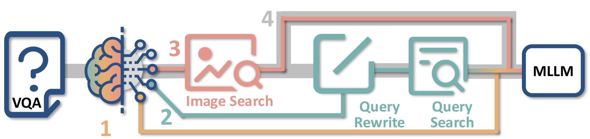

# Efficient Multimodal Planning Agent for Visual Question-Answering

Code for **[Efficient Multimodal Planning Agent for Visual Question-Answering](https://arxiv.org/abs/2601.20676)** (Findings of AACL-IJCNLP 2026). This is the `KB2` branch.

The agent maps each VQA query to one mRAG path:

| Label | Action |
| --- | --- |
| `A` | No retrieval |
| `B` | Image search |
| `C` | Query rewrite + text search |
| `D` | Both |

<p align="center">
  
</p>

## Environment

Qwen2.5-VL-7B-Instruct + [ms-swift](https://github.com/modelscope/ms-swift). A pinned env is in `training/swift3_requirements.txt`.

```bash
pip install ms-swift transformers qwen-vl-utils
```

## Training

1. Build SFT data (`A`–`D` labels) from the source jsonl in `training/training_data/`:

```bash
python training/training_data/make_training_data_0526_more.py
```

2. LoRA SFT (`r=32`, `α=128`; see `training/training_scripts/0526_qwen25_lora32_more.sh`). Replace paths, then merge:

```bash
CUDA_VISIBLE_DEVICES=0,1,2,3 NPROC_PER_NODE=4 MAX_PIXELS=1003520 \
swift sft \
  --model_type qwen2_5_vl \
  --model Qwen/Qwen2.5-VL-7B-Instruct \
  --dataset path/to/train.jsonl \
  --val_dataset path/to/dev.jsonl \
  --output_dir path/to/ckpt \
  --lora_rank 32 --lora_alpha 128 \
  --max_length 1024 --num_train_epochs 3 \
  --per_device_train_batch_size 1 --gradient_accumulation_steps 16

swift export --ckpt_dir path/to/ckpt/best --merge_lora true \
  --model Qwen/Qwen2.5-VL-7B-Instruct
```

3. Dump path decisions:

```bash
python training/inference_kb_model.py --model_id_or_path path/to/ckpt/best-merged -s run_name
```

## Evaluation

Path-conditioned generation: `evaluation/eval_qwen2.5_vl_7b_kb.py` (`--rag norag|image2image|text2text|both`). Example driver: `evaluation/eval_qwen2.5_vl_7b_kb.sh`.

Gold-query annotation, search, and scoring: `evaluation/annotate_gold_query*.py`, `evaluation/search_src/`, `evaluation/score_src/`.

## Citation

```bibtex
@inproceedings{chen-etal-2026-efficient,
  title     = {Efficient Multimodal Planning Agent for Visual Question-Answering},
  author    = {Chen, Zhuo and Geng, Xinyu and Wang, Xinyu and Jiang, Yong and Zhang, Zhen and Xie, Pengjun and Tu, Kewei},
  booktitle = {Findings of the Association for Computational Linguistics: AACL-IJCNLP 2026},
  month     = nov,
  year      = {2026},
  address   = {Hengqin, China},
  publisher = {Association for Computational Linguistics},
  url       = {https://arxiv.org/abs/2601.20676}
}
```
